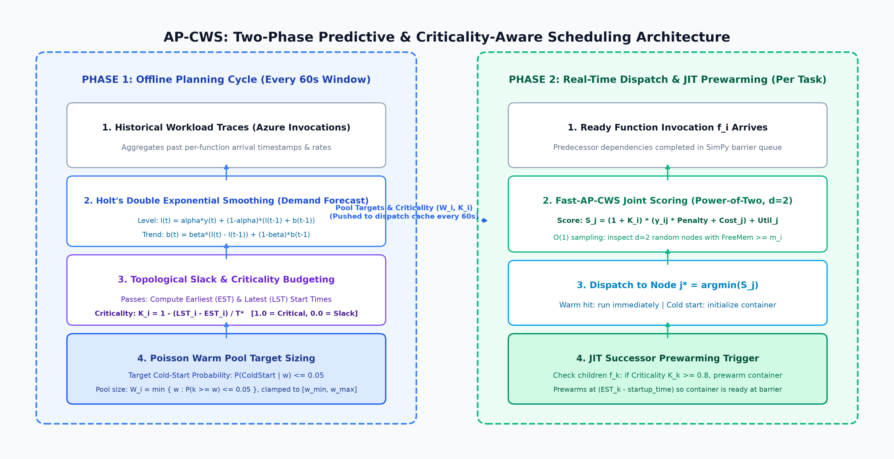
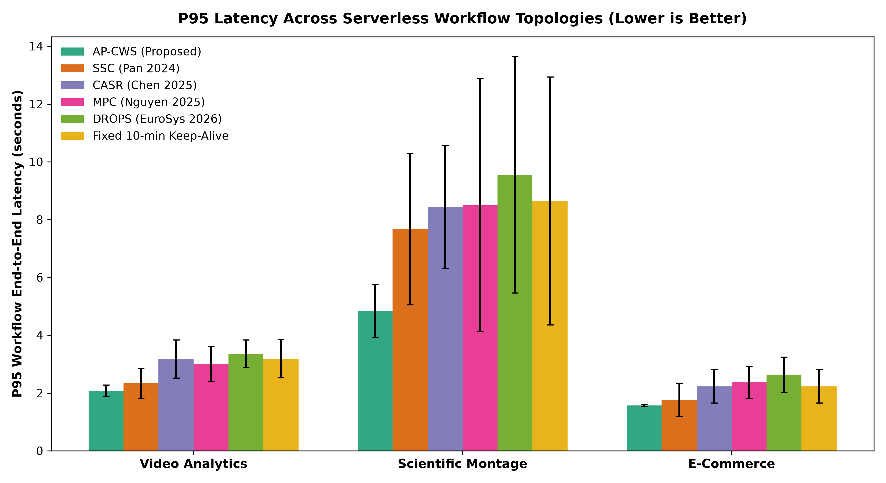
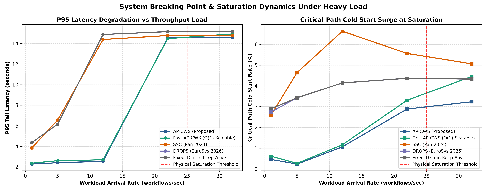

# AP-CWS: Predictive Cold-Start-Aware Serverless Workflow Scheduler

[](https://www.python.org/downloads/)
[](https://simpy.readthedocs.io/)

**AP-CWS** (*Aware-Predictive Cold-Start Workflow Scheduler*) is a dual-loop scheduling framework for Function-as-a-Service (FaaS) Directed Acyclic Graph (DAG) workflows. It mitigates cascading critical-path cold starts by coupling **Holt linear exponential smoothing** demand forecasts, **DAG topological slack budgeting**, **warm-aware multi-factor node scoring**, and **Just-In-Time (JIT) critical successor prewarming**. For high-throughput clusters, **Fast-AP-CWS** memoizes DAG criticality in $O(1)$ and selects nodes via Power-of-Two-Choices ($d=2$) sub-sampling.

**Authors:** Nikhil Sharma, Raghav Arora, and Jashanpreet Singh — Indian Institute of Technology (BHU) Varanasi  
**Base Paper Comparison:** Pan et al., *"Sustainable Serverless Computing With Cold-Start Optimization and Automatic Workflow Resource Scheduling"*, IEEE Transactions on Sustainable Computing (T-SUSC), 2024.

---

## Key Benchmark Results (324 Discrete-Event Simulation Runs)

Evaluated on a 16-node heterogeneous cluster across 3 workflows (`Video Analytics 8F`, `Montage Scientific 9F`, `E-Commerce 6F`), 4 Azure-derived arrival patterns (`stable`, `rising`, `falling`, `bursty`), and 3 random seeds (`42`, `101`, `2024`) from [`src/results/simulation_results_raw.csv`](src/results/simulation_results_raw.csv):

| Scheduling Policy | Mean Lat. (s) | P50 (s) | P95 Lat. (s) | Overall Cold % | Crit-Path Cold % | SLO Viol. % | 5-Min Cost (USD) | Idle RAM (GB-hr) |
| :--- | :---: | :---: | :---: | :---: | :---: | :---: | :---: | :---: |
| **AP-CWS (Proposed)** | **2.41** | **2.33** | **2.83** | **0.58%** | **0.63%** | **0.46%** | **$0.0390** | 3.52 |
| SSC (Pan et al., 2024) | 2.83 | 2.61 | 3.92 | 2.26% | 2.34% | 3.16% | $0.0409 | 3.27 |
| MPC (Nguyen et al., 2025) | 3.12 | 2.86 | 4.62 | 2.19% | 2.21% | 3.63% | $0.0329 | 2.13 |
| CASR (Chen et al., 2025) | 3.36 | 3.18 | 4.61 | 2.91% | 2.95% | 4.92% | $0.0321 | 1.76 |
| Fixed 10-Min Keep-Alive | 3.37 | 3.18 | 4.68 | 2.23% | 2.29% | 3.70% | $0.0344 | 2.12 |
| DROPS (Alquraan et al., 2026) | 3.68 | 3.51 | 5.18 | 2.29% | 2.35% | 4.51% | $0.0466 | 3.62 |

- **27.8% lower P95 latency** vs SSC (2.83 s vs 3.92 s) and **45.4% lower** vs DROPS (5.18 s).
- **85.4% reduction in SLO violations** vs SSC (0.46% vs 3.16%) and **4.6% lower total cost** (\$0.0390 vs \$0.0409 per 5-minute window).
- **Resilience at 12 req/s:** Avoids the Cascading Latency Cliff (2.54 s P95 for AP-CWS vs 14.39 s for SSC and 14.88 s for DROPS/Fixed Keep-Alive), sustaining stable operation up to the 22 req/s 64 GB RAM limit ([`src/results/scalability_stress_results.csv`](src/results/scalability_stress_results.csv)).
- **~3.0x faster dispatch on 128 nodes:** `FastAPCWSSchedulerPolicy` drops per-decision latency from `41.43 us` to `13.94 us` ([`src/results/scalability_overhead_results.csv`](src/results/scalability_overhead_results.csv)).

<p align="center">
  
</p>

<p align="center">
  
  
</p>

---

## Repository Structure

```text
.
├── .gitignore                                 # Ignores Python caches, virtualenvs, TeX build artifacts
├── README.md                                  # Project overview, benchmark summary, quickstart & file map
├── requirements.txt                           # Python dependencies (simpy, numpy, pandas, matplotlib, scipy)
├── paper/                                     # Research manuscripts and compiled paper
│   ├── AP_CWS_FULL_CONFERENCE_PAPER.md        # Full Markdown manuscript with Mermaid diagrams & plots
│   ├── ap_cws_paper.tex                       # IEEEtran LaTeX manuscript source
│   └── ap_cws_paper.pdf                       # Compiled IEEE conference paper (13 pages)
├── src/                                       # Simulator, schedulers, experiments, CLI demo & CSV outputs
│   ├── README.md                              # Detailed code architecture, equations & usage guide
│   ├── ap_cws_simpy_engine.py                 # SimPy discrete-event cluster & container lifecycle engine
│   ├── ap_cws_baselines.py                    # AP-CWS, SSC, CASR, MPC, DROPS, Keep-Alive & ablations
│   ├── run_2nd_evaluation.py                  # Full 324-run evaluation suite & fig1–fig6 generator
│   ├── run_scalability_stress_test.py         # Fast-AP-CWS, breaking-point sweep & fig7–fig8 generator
│   ├── demo.py                                # Interactive / headless CLI demo (Modules 1–6)
│   ├── ap_cws_algorithm.py                    # Standalone Phase-1 prototype scheduler & DAG model
│   ├── ap_cws_enhanced.py                     # Prototype metrics collector, forecasters & tuning helpers
│   ├── ap_cws_tests.py                        # 12 automated unit & integration tests (Phase-1 prototype)
│   └── results/                               # Saved empirical datasets from benchmarks & stress tests
│       ├── simulation_results_raw.csv
│       ├── simulation_results_summary.csv
│       ├── scalability_stress_results.csv
│       └── scalability_overhead_results.csv
└── docs/                                      # Presentation slides, demo scripts, diagrams & plots
    ├── README.md                              # Documentation & figure catalog
    ├── AP-CWS 1st Evaluation (5 slides).pdf   # Phase 1 milestone slide deck
    ├── reports/
    │   └── DEMO_GUIDE.md                      # Live demonstration walkthrough & speaking scripts
    └── figures/                               # Architectural diagrams (diagram1–5) & charts (fig1–8)
```

---

## Quick Start

### 1. Install Dependencies

Requires Python 3.8+ (tested up to Python 3.14):

```bash
pip install -r requirements.txt
```

### 2. Run the Interactive Demo or CLI Modules

```bash
# Interactive 6-module menu
python src/demo.py

# Headless execution of individual modules:
python src/demo.py smoke       # Option 1: 2-node SimPy discrete-event trace (~3s)
python src/demo.py bench       # Option 2: Live comparative benchmark (~10s)
python src/demo.py stress      # Option 3: Throughput stress sweep (~10s)
python src/demo.py overhead    # Option 4: Fast-AP-CWS O(1) dispatch speed (~5s)
python src/demo.py scorecard   # Option 5: Print full 324-run summary tables
python src/demo.py all         # Run all modules sequentially
```

### 3. Run Unit & Integration Tests

```bash
python src/ap_cws_tests.py
# Or from repository root:
python -m unittest discover -s src -p "*tests.py" -v
```

### 4. Reproduce Paper Benchmarks & Figures

```bash
# Re-run the 324-run matrix (writes CSVs to src/results/ and fig1–fig6 to docs/figures/)
python src/run_2nd_evaluation.py

# Re-run the saturation & overhead sweeps (writes CSVs to src/results/ and fig7–fig8 to docs/figures/)
python src/run_scalability_stress_test.py
```

---

## Paper & Documentation Index

| Resource | Purpose |
| :--- | :--- |
| [`paper/AP_CWS_FULL_CONFERENCE_PAPER.md`](paper/AP_CWS_FULL_CONFERENCE_PAPER.md) | Full Markdown manuscript with Mermaid diagrams, equations, tables, and embedded charts |
| [`paper/ap_cws_paper.tex`](paper/ap_cws_paper.tex) | IEEEtran LaTeX manuscript (configured with `\graphicspath{{../docs/figures/}}` for Overleaf/TeX compilation) |
| [`paper/ap_cws_paper.pdf`](paper/ap_cws_paper.pdf) | Compiled conference paper PDF |
| [`src/README.md`](src/README.md) | Detailed breakdown of modules, mathematical formulations, and CLI options |
| [`docs/reports/DEMO_GUIDE.md`](docs/reports/DEMO_GUIDE.md) | Step-by-step demonstration guide and Q&A notes |
| [`docs/README.md`](docs/README.md) | Catalog of architectural diagrams (`diagram1`–`5`) and benchmark charts (`fig1`–`8`) |
